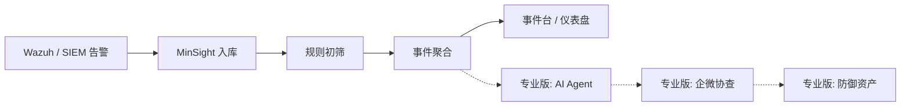

# Wazuh 告警太多？用开源 MinSight 做 SIEM 之上的智能分诊

> **一句话**：SIEM 负责「发现」，MA-MinSight 负责「消化」——社区版免费把告警收进来、降噪、聚成事件；专业版再解锁 AI 研判与企微协作。

**开源仓库**

- GitHub：https://github.com/jarland1022/Ma-minsight-basic  
- Gitee：https://gitee.com/jarland/Ma-minsight-basic  

**协议**：Apache-2.0｜**同系列**： [Ma-WAF 社区版](https://github.com/jarland1022/Ma-waf-basic)（Web 防护）

---

## 1. 先说结论

很多团队已经上了 Wazuh、ELK，或某套国产 SIEM。真正难的往往不是「有没有告警」，而是：

- 每天几千条，真正值得盯的不到 1%  
- 同一主机、同一规则反复刷屏  
- 新人看不懂规则 ID，老人靠经验「肉眼过滤」  
- 想上大模型聊天写结论，却没有入库、聚合、审计闭环  

再买一个 SIEM，通常只会让告警更多。缺的是 **SIEM 之上的分诊与研判层**。

MA-MinSight 做的就是这件事：把检测结果变成可值班、可升级的运营工作流。

---

## 2. MinSight 不是又一个 SIEM

定位要说清，否则读者会误解成「再装一套检测产品」。

| 角色 | 典型产品 | 干什么 |
|------|----------|--------|
| 检测与采集 | Wazuh / EDR / 防火墙日志 | 产生告警 |
| 分诊与研判 | **MA-MinSight** | 入库、降噪、聚合、（专业版）AI 调查与协作 |

流水线可以概括为：

```text
告警入库 → 规则初筛 → 事件聚合 →（专业版）AI Agent 调查
                              →（专业版）人工协查（企微等）
                              →（专业版）防御资产沉淀
```

- **吃什么**：SIEM / EDR 已经产出的告警（社区版优先对接 Wazuh Indexer，也可用 Mock 演示）  
- **吐什么**：更少、更可行动的「事件」，以及（专业版）结构化结论与协作记录  

和 Wazuh 的关系很简单：**Wazuh 负责发现，MinSight 负责消化。**



---

## 3. 为什么「只加规则」或「只聊大模型」都不够

### 3.1 只加 SIEM 规则

规则越多，误报与重复告警往往越多。值班压力上升，信噪比未必变好。

### 3.2 只把告警贴进 ChatGPT / 国产大模型

可以写一段分析文字，但通常没有：

- 稳定的告警入库与去重  
- 按主机 / 用户 / 类别的时间窗聚合  
- 可审计的调查过程与结论落库  
- 和企微、白名单、处置建议的闭环  

### 3.3 MinSight 的取舍

把「能跑通的运营流水线」放在前面：先让告警变成事件；再在专业版里用 Agent 与协作把事件变成结论。

---

## 4. 社区版免费能做什么

社区版面向：**自己装、自己验证、自己对接现有 Wazuh**。

| 能力 | 说明 |
|------|------|
| 告警入库 | Wazuh Indexer / Mock |
| 规则初筛 | 降噪、白名单、归档或进入待聚合；仪表盘可看噪声规则 |
| 事件聚合 | 主机 + 用户 + 类别 + 时间窗 → Event |
| 技能库 | 精选 Playbooks + 社区扩展包；**ATT&CK 覆盖看板** |
| 控制台 | 仪表盘、事件队列、使用指南、顶栏 License 提示 |
| License | 仓库已含验签公钥；导入 `license.lic` 后重启升专业版 |

**社区版默认不包含**：LLM ReAct Agent、企微人工协查、防御资产学习闭环、回归/探针评测、商用驻场支持。

设计原则很直白：

- 社区版必须能 **15 分钟内** 看到「告警变成事件」，并能打开技能库，否则开源没有说服力  
- 专业版必须锁住 Agent 与企业协作，否则没有付费理由  
- **没有**「装上就送 72 小时专业版」的静默试用，避免开源仓库被当商业版白嫖  

完整对照见：[`docs/community-vs-pro.md`](https://github.com/jarland1022/Ma-minsight-basic/blob/main/docs/community-vs-pro.md)

---

## 5. 上手：Docker 跑起来（社区版）

环境：Docker（推荐）。也可 Python ≥3.11 + Node 18+ + PostgreSQL + Redis，见仓库 README。

```bash
git clone https://github.com/jarland1022/Ma-minsight-basic.git
# 国内也可：git clone https://gitee.com/jarland/Ma-minsight-basic.git

cd Ma-minsight-basic
cp .env.example .env
# 编辑 POSTGRES_PASSWORD、API_KEY、JWT_SECRET 等

docker compose up -d --build
```

Compose 会挂载 `./configs/license`，导入的专业版授权不会因重建镜像丢失。

常见入口（以 `.env` 中 `HTTP_PORT` 为准，默认 80）：

| 地址 | 作用 |
|------|------|
| http://127.0.0.1/ | Web 控制台 |
| 应用 `/health` | 健康检查（应能看到 `edition=community`） |

登录后建议路径：

1. 打开 **设置 → 手动运行流水线**  
2. 依次执行：**告警入库 → 初筛分诊 → 事件聚合**（可先用 Mock 数据源验证）  
3. 到 **事件队列** 确认已生成 Event  
4. 打开 **技能库**，浏览 Playbooks / ATT&CK 覆盖  
5. 需要接真实环境时，再配置 Wazuh Indexer 数据源  

> 发布本文时请自行补 3～5 张截图：登录页、仪表盘、事件列表、技能库、License 页。有图转化率会高很多。

---

## 6. 专业版：什么时候该付钱

当你已经确认「入库 / 初筛 / 聚合」有用，并且出现下面任一需求，再考虑专业版：

1. **AI Agent 深度调查**  
   对 Event 做 ReAct 式调查，调用资产 / 历史告警 / 情报 / 行为时间线 / 样本富化等 Skill，输出结构化结论（含处置分级）。  

2. **企微人工协查**  
   把问题推给业务或主机负责人，用白话回复，而不是让所有人学规则 ID。  

3. **防御资产闭环**  
   判例、白名单候选、处置建议等沉淀，减少「每次从零开始」。  

4. **评测与商用支持**  
   回归 / 链路探针，以及对公合同、工作日支持、私有化 SOP。  

### 如何升级（同一套安装，不用重装）

1. 控制台打开 **系统 → License**，复制机器指纹  
2. 联系厂商获取 `license.lic`（验签公钥已在仓库 `configs/license/ma-minsight-public.pem`）  
3. 在页面导入 `.lic`，**重启应用**  
4. 顶栏会显示 Pro；Agent、协查、防御资产、评测相关能力可用  

**联系方式**

- 微信：`jarlandliu`  
- 邮箱：`jarland@mingansec.com`  

### 定价参考（可合同协商）

| 项目 | 参考 |
|------|------|
| 社区版 | 免费（Apache-2.0） |
| 专业版 | 约 ¥9,800 / 节点 / 年（对标 SOC 配套工具，非「再卖一套规则」） |
| 更高档 | 多节点、驻场调优、私有化 SOP 另议 |

具体以沟通与合同为准；上表仅方便读者建立预算量级。

---

## 7. 适合谁 / 不适合谁

**比较适合**

- 已有或准备自建 Wazuh，被告警量压住的中小安全 / 运维团队  
- 想先用开源验证「分诊层」值不值得上，再决定是否买专业版  
- 需要私有化、数据不出内网的场景  

**暂时不适合当作唯一答案**

- 还没有任何检测源、连日志都没收齐——请先把 SIEM/采集做好  
- 期望「装上就自动等保一次性通过」——MinSight 不承诺这类结果  
- 想找「零运维的纯 SaaS 开箱」——当前主路径是自托管  

---

## 8. 和 Ma-WAF 怎么一起用（可选）

同系列还有开源 **Ma-WAF Community**（Nginx + ModSecurity + CRS 思路的自托管 WAF）：

https://github.com/jarland1022/Ma-waf-basic  

一个常见组合是：

- **Ma-WAF**：在入口挡住一部分 Web 攻击，控制台能看到拦截效果  
- **Wazuh + MinSight**：对主机 / 系统侧告警做分诊与研判  

防护与检测分诊不是互相替代，而是前后衔接。

---

## 9. 你现在可以做的三件事

1. **Star / Clone 社区版**，按上文 Compose 跑通「入库 → 初筛 → 聚合」  
   - https://github.com/jarland1022/Ma-minsight-basic  
   - https://gitee.com/jarland/Ma-minsight-basic  
2. 若事件台已经有用、还需要 AI 与企微协作：打开 License 页复制指纹，微信 `jarlandliu` 申请试用或正式授权。  
3. 把本文转给同样被 Wazuh 告警淹没的同事——开源项目最缺的不是功能列表，而是「有人真的装上并反馈」。

---

## 附录：发布用标签（知乎 / 掘金 / CSDN）

`Wazuh` `SIEM` `SOC` `安全运营` `告警降噪` `开源` `Docker` `MA-MinSight`

## 附录：免责声明

本文介绍开源社区版的能力边界与专业版升级路径，不构成等保、密评或渗透测试结论；生产环境请自行评估数据源权限、密钥与网络隔离。厂商联系方式用于产品咨询与授权，请勿用于与产品无关的骚扰。
