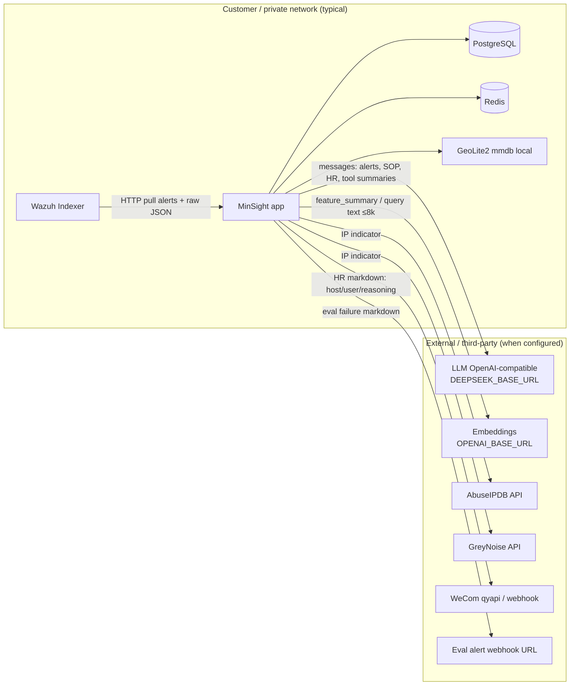

# P0-06 Phase 1 — Data Flow & Privacy Boundary Audit

**Version:** 1.0.2  
**Date:** 2026-11-06  
**Status:** Audit complete — **implementation not started**  
**Scope:** Static code / config / docs inspection only  
**Companions:** `CODEBASE_AUDIT.md` · `IMPLEMENTATION_PLAN.md` · `PRODUCT_OWNER_DECISIONS.md` (D-DATA-*, O-08/O-09 Proposed) · **Phase 2 design:** `P0_06_IMPLEMENTATION_DESIGN.md`  
**Constraint:** No application code, tests, migrations, or configuration were modified in this phase.

**Evidence legend:** Static | Unit-tested (referenced only) | Not Found | UNKNOWN (needs runtime) | NOT VERIFIED

**v1.0.1:** Independent re-verification of egress modules against current tree; clarifications on Docker network naming vs egress isolation, embedding gate location, `.env.example` BYO gap, WeCom inbound webhook (ingress).  
**v1.0.2:** Phase 2 implementation design published (`P0_06_IMPLEMENTATION_DESIGN.md`). Audit evidence below is **preserved**; design does not supersede this inventory.

---

## 1. Executive summary

MinSight **pulls full Wazuh alert documents into the local PostgreSQL database**, retains rich investigation artifacts locally (including full ReAct message history), and—when integrations are configured—**transmits security-relevant context to external services**.

The highest-impact egress path is the **LLM chat-completions API** (`app/llm/client.py`): investigation prompts include hostnames, usernames, source IPs, URLs, SOP text, reference cases, and human-review replies. There is **no** centralized PII/secret redaction on that path. Default base URL is `https://api.deepseek.com` (customer-replaceable via settings/`DEEPSEEK_BASE_URL`; **not** listed in `.env.example` — disclosure gap).

Additional outbound paths (when keys/URLs are set): AbuseIPDB / GreyNoise (public IP indicators), OpenAI-compatible embeddings, WeCom / optional eval webhooks. Application-level product telemetry was **Not Found**. Docker Compose defines a network **named** `internal` with `driver: bridge` but **without** Compose `internal: true`; that name is **not** an egress firewall (D-DATA-03).

**Bottom line:** on-prem deployment does **not** imply alerts stay inside the customer environment. Privacy claims must be conditional on configuration and must not assert air-gap without verified egress controls.

---

## 2. Architecture and data-flow diagram

**Notes**

- Wazuh Indexer is usually customer-owned; the pull still moves full alert JSON into MinSight storage.
- CMDB tool-gateway adapter is currently a **local mock** (no live HTTP); gateway default `tools.gateway_enabled=false`.
- GeoIP uses a local MaxMind DB file when configured — no MaxMind cloud call found in app code.

---

## 3. Data sources inventory (code-backed)

### 3.A Wazuh / alert data

| Category | Source | Processing | Storage | Retention (code) | Assessment |
|----------|--------|------------|---------|------------------|------------|
| Raw alert JSON | `WazuhIndexerClient.search_alerts` → `map_wazuh_alert` (`app/ingestion/adapters/wazuh/client.py`, `mapper.py`) | Normalize + store | `alerts.raw_data` JSONB (`app/models/ingestion.py`) | **Not Found** app retention/purge for production alerts | PARTIAL — collected fully; retention unknown |
| Rule id/name/severity | mapper | Local | `alerts.rule_*`, `severity` | Same | PASS (local) |
| Agent / host | `agent.name`, `agent.ip` | Local + optional GeoIP | `host_name`, `normalized_fields` | Same | PASS (local) |
| IPs / ports | `data.srcip` etc. | Local; TI sync may export public IP | `src_ip`/`dst_ip` INET | TI cache TTL hours only for intel rows | PARTIAL |
| Usernames | `dstuser`/`srcuser`/`uid` | Local; LLM/WeCom may egress | `user_name` | Same | GAP if LLM/WeCom on |
| File / process | syscheck / process fields | Local | `process_*`, `file_hash` | Same | PASS (local storage) |
| Timestamps / metadata | `_source` | Local | `occurred_at`, fingerprint | Same | PASS |
| Full-log excerpt | `full_log`[:500] into normalized_fields | Local | JSONB | Same | PASS (local); may later enter LLM via other fields |

**Evidence:** `map_wazuh_alert` sets `raw_data=raw` (full document) at `app/ingestion/adapters/wazuh/mapper.py` (~L157). Ingest persists via `ingest_service` `raw_data` field.

### 3.B Investigation context

| Category | Source | Processing | Storage | External? | Assessment |
|----------|--------|------------|---------|-----------|------------|
| Investigation prompts | `build_system_prompt` / `build_user_prompt` (`prompts.py`) | Assembled in AgentLoop | Also persisted as `investigation_messages` | Yes → LLM when key set | GAP |
| Agent / tool messages | `AgentLoop` (`loop.py`) | ReAct loop; tool **summary** (not full `SkillResult.data`) returned to model | `investigation_messages.content` | Yes → LLM | PARTIAL (summary-only tools helps) |
| Threat intel enrichment | Sync: external APIs → DB; Skill: **local cache only** (`query_threat_intel.py`) | Sync outbound IP; skill reads DB | `threat_intel_entries` (+ `raw_response`) | Sync yes / skill no | PARTIAL |
| Asset / entity | `query_asset`, entity graph | Local DB (+ Redis cache 600s) | entity_* tables; Redis | Optional mock CMDB only | PASS |
| Historical alerts | `query_history_alerts` | Local DB; summary to LLM | alerts/events | Indirect via LLM summary | PARTIAL |
| SOP / playbooks | `InvestigationSop`, `app/playbooks/` | Local; SOP text in system prompt | DB / files | SOP → LLM | PARTIAL |
| Human Review Q/A | HR service + WeCom | Outbound markdown; replies re-enter prompts | `human_review_*` | WeCom + LLM | GAP |
| Evidence refs / conclusions | skills + `submit_conclusion` | Local | investigations / conclusions | Reasoning may go to WeCom/LLM | PARTIAL |
| Reference cases | `fetch_reference_cases` | Local; JSON in system prompt; optional embed query | `judgment_cases` (+ embedding array) | Embed API if enabled | PARTIAL |

**Prompt fields sent to LLM (investigation):** event title/category/risk, aggregate host/user, per-alert rule/severity/**src_ip**/geo/user/host/**request_url**/triage; SOP guidance; reference `feature_summary` + reasoning excerpt; latest answered HR reply. **Full `raw_data` is not directly serialized in `build_user_prompt`** (Static minimization partial). `request_url` is derived from raw/normalized fields (`extract_request_url`).

### 3.C Other data

| Category | Source | Storage | External? | Assessment |
|----------|--------|---------|-----------|------------|
| Users / admins / pilots | auth, users routes | `users` (password_hash, mfa_secret) | Not Found outbound identity sync | PASS local; protect at rest via infra UNKNOWN |
| Auth metadata | JWT, login rate limit | Redis + tokens | Not Found | PASS |
| System config | `system_config` + env | DB + process env | Secrets in env; audit redacts keys | PARTIAL |
| API keys / secrets | env + `api_keys` | hashed keys in DB; env plaintext | Sent as Bearer/Key headers to LLM/TI/embed | PARTIAL — header use expected; logging risk |
| Eval / regression | cases, runs, export.jsonl | DB; export audited | Optional webhook on failure | PARTIAL |
| Embeddings / vectors | `EmbeddingService` | `judgment_cases.embedding` ARRAY | OpenAI-compatible when enabled | PARTIAL — default off |
| Application logs | std logging | stdout / operator shipping | Operator log agents **UNKNOWN** | NOT VERIFIED at runtime |
| Audit logs | `audit_redact.redact_for_audit` | `audit_logs` | Local | PASS for secret keys in audit path |
| Errors / stack traces | `logger.exception` in LLM/TI/embed/WeCom | logs | May include exception strings; full LLM payload **Not Found** in logs | PARTIAL |
| Telemetry / usage analytics | — | — | **Not Found** in app | PASS (no product telemetry found) |
| Backup / export | compose volumes `pgdata`/`redisdata`; regression export; `backups/` tree present in workspace | Host volumes / files | Operator-dependent | NOT VERIFIED — infra |

---

## 4. External destination inventory

| # | Destination | Initiator | Data transmitted | Raw alerts? | Sensitive? | Optional? | Configurable? | TLS / timeout | Failure behavior | Request/response logged? | Disable? | Assessment |
|---|-------------|-----------|------------------|-------------|------------|-----------|---------------|---------------|------------------|--------------------------|----------|------------|
| 1 | `{DEEPSEEK_BASE_URL}/chat/completions` default `https://api.deepseek.com` | `LLMClient.chat` `app/llm/client.py` L39–54 | Full `messages` + `tools` | **Derived** alert table + context (not full raw JSON in prompt builder) | IP, user, host, URL, SOP, HR, tool summaries | Empty key → hard fail on chat | Base URL + key + model env | httpx default TLS verify; timeout **120s** | Raises; ops failure path (P0-03) | **Not Found** payload logging | Omit key / point to private endpoint | **GAP** |
| 2 | Same LLM via triage assist | `LlmAssistHandler._score_alert` | JSON summary: rule, severity, category, src_ip, host, user | No full raw | Yes | Default **off** (`triage.llm_assist_enabled=False`) | System config | Same client | Skip step on error | Cache score in Redis only | Disable flag / empty key | PARTIAL |
| 3 | `{OPENAI_BASE_URL}/embeddings` | `EmbeddingService.embed` (`embedding.py` L19–40); gated by callers via `defense_assets.embedding_enabled` / `embedding_search_enabled` (`pipeline.py` L182; `retrieval.py` L22) — **`embed()` itself does not check the flag** | Text ≤8000 chars; key = `openai_api_key` **or fallback** `deepseek_api_key` | No | May include host/user in query or case summary | Default **off** in defense config | URL + key + flags | TLS default; timeout **30s** | Returns None; logs exception | Exception logging only | Flags + empty keys | PARTIAL |
| 4 | `https://api.abuseipdb.com/api/v2/check` | `AbuseIPDBProvider.lookup_ip` | `ipAddress` + maxAge | No | Public IP | Empty `ABUSEIPDB_API_KEY` | Key + max age + skip private | Timeout from `threat_intel_http_timeout_seconds` (30) | Skip/fail per IP; continue | Warning/exception logs (IP in message) | Omit key | PARTIAL |
| 5 | `https://api.greynoise.io/v3/community/{ip}` | `GreyNoiseProvider.lookup_ip` | IP in path | No | Public IP | Empty `GREYNOISE_API_KEY` | Key | Same | 404/429 → None | Same | Omit key | PARTIAL |
| 6 | `https://qyapi.weixin.qq.com/...` + optional webhook | `WeComAdapter` | HR markdown (title, host, user, reasoning, query) | No | Yes | Unconfigured → no send | Corp/webhook env | timeout **30s** | Fallback webhook; else fail | Token errors logged | Don’t configure | GAP for privacy disclosure |
| 7 | `eval.alert_webhook_url` | `notify_eval_failure` | title + detail markdown | No | Possibly run metadata | URL null by default | System config | timeout **10s** | Log exception | Exception only | Unset URL | PARTIAL |
| 8 | Customer Wazuh Indexer URL | `WazuhIndexerClient` | Search queries; **receives** full hits | N/A (ingress of data) | Creds in Basic auth | Disable data source | Per data_source config; `verify_tls` / CA | Configurable timeout | Retry/fail ingestion | Diagnostics | Disable source | PASS as customer pull (location UNKNOWN) |
| 9 | Tool gateway CMDB | `CmdbAdapter` | — | — | — | Gateway default off | `tools.gateway_enabled` | N/A mock | — | Audit keys only | Default off | PASS (mock; no live HTTP) |

**Package/update/telemetry services:** **Not Found** in application runtime code (image build/supply-chain is out of app data-flow scope; host package managers **UNKNOWN**).

---

## 5. Data-flow matrix (summary)

| Data category | Actual source | Processing location | Storage location | External destination | Sensitive fields | Protection | Configuration | Evidence | Assessment |
|---------------|---------------|---------------------|------------------|----------------------|------------------|------------|---------------|----------|------------|
| Alert raw JSON | Wazuh mapper | App ingest | PostgreSQL `alerts.raw_data` | None directly | Full payload | AuthZ to API; **no** field redaction layer | Disable data source | `mapper.py` L157; `models/ingestion.py` | PARTIAL |
| Alert indicators in LLM prompt | `context_builder` + `prompts.build_user_prompt` | App → LLMClient | Also `investigation_messages` | LLM base URL | src_ip, user, host, url | **No** egress redaction | Empty API key; BYO URL | `prompts.py` L83–111; `client.py` L39–54 | **GAP** |
| Triage LLM score | `llm_assist.py` | App → LLM | Redis score cache | LLM | ip/host/user | Default off | `triage.llm_assist_enabled` | `llm_assist.py` L83–99 | PARTIAL |
| TI IP sync | `ThreatIntelSyncService` | App → providers → DB | `threat_intel_entries` | AbuseIPDB/GreyNoise | Public IP | Skip private IPs default True | Empty keys; skip_private | `sync_service.py`; providers | PARTIAL |
| TI skill lookup | `QueryThreatIntelSkill` | Local DB only | Same | None | IOC value in summary → LLM | Cache TTL | N/A | `query_threat_intel.py` | PASS (local skill) |
| HR outbound | `build_review_message` → WeCom | App → Tencent / webhook | `human_review_requests` | WeCom | host, user, reasoning | Truncate max_chars | Don’t configure WeCom | `message_builder.py` L37–55; `wecom/adapter.py` | **GAP** |
| Embeddings | `EmbeddingService` | App → embed API | PG vector column | OPENAI_BASE_URL | Case/query text | Default disabled | Flags + keys | `embedding.py` L19–40; defense config | PARTIAL |
| Secrets in audit | Config/auth mutations | `redact_for_audit` | `audit_logs` | None | passwords/keys | Key-fragment + regex redact | Always on audit helpers | `audit_redact.py` | PASS (audit only) |
| Eval webhook | `notify_eval_failure` | App → URL | — | Customer-chosen URL | title/detail | Optional | Unset URL | `eval/notifications.py` | PARTIAL |
| User credentials | Auth | bcrypt hash | `users.password_hash` | None | passwords | Hashing; MFA secret column | — | `auth.py` / `models/system.py` | PASS local |
| Product telemetry | — | — | — | — | — | — | — | Search Not Found | PASS |

---

## 6. Redaction and minimization analysis

### Data minimization

| Question | Finding |
|----------|---------|
| Full raw alert sent to LLM? | **Not in prompt builder** — table of extracted fields, not entire `raw_data`. **However**, tool/history/SOP/HR/reference text can be rich. Assessment: **PARTIAL**. |
| Only relevant fields? | Fixed field set in `build_user_prompt`; no admin allowlist/deny-list. |
| User/IP/host/path minimized? | **No** — explicitly included. |
| Historical records unnecessary? | Up to 20 alerts in prompt (`alert_limit`); history skill returns summary counts to model (full alert list in `SkillResult.data` **not** appended to messages — only `summary`). Reference cases up to 3. |

### Redaction

| Question | Finding |
|----------|---------|
| Centralized redaction layer? | **Only** `app/services/audit_redact.py` for **audit/pipeline audit** payloads — **not** LLM/TI/WeCom/embed. |
| Consistent on all external integrations? | **No**. |
| Bypass paths? | Yes: LLM, WeCom, embeddings, TI, eval webhook, and any future gateway HTTP. |
| Prompts / tool results / errors / logs covered? | Prompts: no. Tool summaries: no. Logs: incidental; no systematic PII scrubber **Not Found**. |
| Secrets protected from logging? | Audit path yes; LLM client does not log Bearer token; WeCom may log gettoken error bodies (**review**). Env dumps **UNKNOWN**. |

### Configuration and consent

| Question | Finding |
|----------|---------|
| Customer-owned LLM endpoint? | **Yes (code):** `settings.deepseek_base_url` default `https://api.deepseek.com` (`app/core/config.py` L48). Env alias `DEEPSEEK_BASE_URL` via pydantic settings. **Gap:** `.env.example` documents `DEEPSEEK_API_KEY` / model but **Not Found** `DEEPSEEK_BASE_URL` (O-08 **Proposed**). |
| Disable external LLM transmission? | **De facto** by empty `DEEPSEEK_API_KEY` (chat raises at `client.py` L36–37). No dedicated `air_gap_mode` / named kill-switch **Not Found**. Investigations require LLM when run. |
| TI independently disabled? | **Yes** — omit provider keys; sync returns error “No threat intel provider configured” (`sync_service.py` ~L60). Private IPs skipped when `threat_intel_skip_private_ips=True` (default). |
| Embedding independently disabled? | **Yes** — `defense_assets.embedding_enabled` default `False`; callers gate before `embed()`. Empty keys also skip. |
| Defaults safe for private deploy? | LLM key empty by default in `.env.example`; DeepSeek **URL** still defaults to public API when key is added. Triage LLM off; embedding off; TI off without keys; WeCom off. |
| Behavior documented for customers? | Plan baseline mentioned; **no** published customer `DATA_FLOW.md` yet (this audit is the evidence base). |
| WeCom directionality | Outbound: HR markdown to corp API / webhook. **Inbound:** `/webhooks/wecom` verifies + accepts analyst replies (`human_review.py`) — replies re-enter investigation prompts locally then may re-egress to LLM. |

---

## 7. Storage and retention analysis

| Store | Contents | At-rest encryption (app) | Retention control | Deletion / export |
|-------|----------|--------------------------|-------------------|-------------------|
| PostgreSQL | Alerts (incl. raw_data), investigations, messages, HR, TI raw_response, embeddings, users, audit | **Not Found** in app (infra/TDE **UNKNOWN**) | Production alert retention **Not Found**; eval probe retention config exists (`eval.probe_retention_days`) | Cascade on some FKs; no general GDPR-style erase API **Not Found**; regression `export.jsonl` audited |
| Redis | LLM triage scores, asset skill cache, locks, rate limits | **UNKNOWN** | TTLs (e.g. LLM cache 86400s; asset 600s) | Ephemeral |
| GeoLite2 file | IP→geo | File on disk | Operator | Local only |
| Docker volumes | pgdata, redisdata | Host dependent | Operator backups | Operator |
| Workspace `backups/` | Present in tree | N/A | Operator | **NOT VERIFIED** contents policy |

Sensitive records are **access-controlled** via auth/RBAC for API reads; that is not a substitute for egress redaction or retention policy.

---

## 8. Network boundaries

| Control | Evidence | Assessment |
|---------|----------|------------|
| App unrestricted outbound | httpx clients call public URLs when keys set; no allowlist middleware **Not Found** | GAP vs air-gap claims |
| Docker network | `docker-compose.yml` network **named** `internal` with `driver: bridge` only — Compose **`internal: true` Not Found**; containers can still use host NAT/outbound if OS allows | Per D-DATA-03: topology / naming ≠ privacy |
| Unexpected external communication | Static inventory above; runtime DNS must confirm | NOT VERIFIED runtime |
| Infra vs app | Security groups / egress mentioned in deploy docs as operator responsibility | UNKNOWN per customer |

---

## 9. Privacy-claim verification matrix

| # | Statement | Classification | Evidence / limitations |
|---|-----------|----------------|------------------------|
| 1 | "Security alerts remain entirely within the customer's environment." | **FALSE** (as universal claim) / **PARTIALLY VERIFIED** only if LLM/TI/WeCom/embed/webhooks unset **and** indexer+DB stay customer-side | LLM/WeCom/TI code paths egress; D-DATA-02 forbids unverified absolute claims |
| 2 | "MinSight does not transmit raw security alerts to external services." | **PARTIALLY VERIFIED** | Full `raw_data` JSON **not** placed wholesale into LLM prompt builder; **derived** alert fields **are** transmitted. Absolute “raw alerts” wording is ambiguous — do not use without definition. |
| 3 | "Customers can use their own LLM endpoint." | **VERIFIED** (code capability) / **PARTIALLY VERIFIED** (operator docs) | Code: `settings.deepseek_base_url` → `{base}/chat/completions`. Formal product stamp still O-08 **Proposed**. Operator discoverability weakened: `.env.example` omits `DEEPSEEK_BASE_URL`. |
| 4 | "External integrations can be independently disabled." | **PARTIALLY VERIFIED** | TI/embed/WeCom/eval/triage-LLM via keys/flags; primary investigation LLM only via empty key (no named kill-switch). |
| 5 | "Sensitive information is redacted before external transmission." | **FALSE** | No egress redaction on LLM/WeCom/TI/embed; audit redaction only. |
| 6 | "All investigation data is stored locally." | **PARTIALLY VERIFIED** | Authoritative store is local PG/Redis; **copies** of prompt/tool content leave via LLM; HR content via WeCom. |
| 7 | "MinSight has no external telemetry." | **PARTIALLY VERIFIED** | Product telemetry **Not Found** in app code; host agents / Docker pull / operator monitoring **UNKNOWN**. |

---

## 10. Risk register

### P0-DATA-01 — Investigation context egress to LLM without redaction

| Field | Content |
|-------|---------|
| Severity | **P0** (privacy boundary / production disclosure) |
| Affected data | src_ip, user_name, host_name, request_url, event titles, SOP, HR replies, reference cases, tool summaries |
| Code path | `AgentLoop` → `build_initial_messages` → `LLMClient.chat` |
| Evidence | `app/agent/prompts.py` L83–111; `app/llm/client.py` L39–54; default `deepseek_base_url` |
| Exposure | Customer alert context processed by third-party or BYO model provider; provider logging/retention outside MinSight control |
| Business impact | Undermines air-gap / “data never leaves” sales claims; contractual/privacy risk |
| Remediation | Publish DFD; mandatory disclosure; optional field allowlist + redaction; explicit `egress` policy / air-gap mode; prefer BYO endpoint |
| Acceptance | Contract tests that fail if deny-listed fields appear in outbound payload when policy=strict; docs match behavior |
| Tests | **Not Found** egress contract tests today |

### P0-DATA-02 — No centralized egress redaction

| Field | Content |
|-------|---------|
| Severity | **P0** |
| Affected data | All external channels |
| Code path | Contrast `audit_redact.py` (audit-only) vs LLM/WeCom/TI/embed |
| Evidence | `app/services/audit_redact.py`; absence of imports from LLM/WeCom paths (**Static**) |
| Exposure | Secrets/PII can leave via non-audit channels |
| Remediation | Shared egress filter applied to all outbound HTTP bodies (configurable profiles) |
| Acceptance | Single module used by LLM, WeCom, embed, webhooks; unit tests per channel |
| Tests | Extend beyond audit-only |

### P1-DATA-03 — WeCom Human Review markdown includes host/user/reasoning

| Field | Content |
|-------|---------|
| Severity | **P1** |
| Code path | `message_builder.py` → `WeComAdapter` → `qyapi.weixin.qq.com` |
| Evidence | L37–55 message_builder; adapter L45–65 |
| Impact | Security context to SaaS IM; may be outside customer “security zone” depending on WeCom tenancy |
| Remediation | Disclosure; minimization template; disable path; customer-controlled bot |
| Acceptance | Documented fields list; config to strip identifiers |

### P1-DATA-04 — Threat intel sync shares public IPs with third parties

| Field | Content |
|-------|---------|
| Severity | **P1** |
| Code path | `ThreatIntelSyncService` + AbuseIPDB/GreyNoise |
| Evidence | providers; `threat_intel_skip_private_ips` default True |
| Impact | Indicator sharing / attribution leakage to TI vendors |
| Remediation | Keep opt-in keys; disclose; optional local-only intel |
| Acceptance | Disabled by default remains; docs warn |

### P1-DATA-05 — Unlimited retention of raw alerts and investigation messages

| Field | Content |
|-------|---------|
| Severity | **P1** |
| Code path | `alerts.raw_data`; `investigation_messages` |
| Evidence | Models; retention **Not Found** except eval probe days |
| Impact | Long-term sensitive data store; compliance gap |
| Remediation | Configurable retention + purge jobs; export/delete runbooks |
| Acceptance | Documented TTLs; tested purge |

### P2-DATA-06 — No application egress allowlist / air-gap mode

| Field | Content |
|-------|---------|
| Severity | **P2** |
| Evidence | httpx unbounded; compose bridge only |
| Remediation | Feature flag refusing non-local base URLs; optional network policy docs |
| Acceptance | Mode documented + tested |

### P2-DATA-07 — Embedding path can upload case/query text when enabled

| Field | Content |
|-------|---------|
| Severity | **P2** |
| Evidence | `embedding.py`; defaults off (O-09 Proposed) |
| Remediation | Keep default off; disclose; redact before embed |
| Acceptance | Flag matrix tests |

### INFO-DATA-08 — Operator log/metrics agents and host egress unverified

| Field | Content |
|-------|---------|
| Severity | **INFO** |
| Evidence | Outside app code |
| Remediation | Runtime verification plan (§11) |
| Acceptance | Per-deployment checklist |

### INFO-DATA-09 — AUD-DATA-001 confirmed and expanded

Prior audit finding AUD-DATA-001 remains valid; this document is the detailed DFD evidence base.

### INFO-DATA-10 — BYO LLM base URL under-documented in `.env.example`

| Field | Content |
|-------|---------|
| Severity | **INFO** |
| Evidence | `app/core/config.py` L48 has `deepseek_base_url`; `.env.example` lists `DEEPSEEK_API_KEY` / `DEEPSEEK_MODEL` but **Not Found** `DEEPSEEK_BASE_URL` |
| Impact | Operators may assume only DeepSeek cloud is supported |
| Remediation | Document in env examples + customer `DATA_FLOW.md` under P0-06 implementation |
| Acceptance | Example env + docs list BYO base URL |

---

## 11. Runtime verification plan

Do **not** use real customer production alert corpora. Use synthetic fixtures.

| ID | Test | Goal |
|----|------|------|
| RV-01 | Capture DNS/TCP from app container during idle + investigation (tcpdump/ss/ebpf or HTTP proxy) | Enumerate real destinations |
| RV-02 | Mitmproxy / logging HTTP wrapper on LLM base URL with synthetic event | Confirm payload fields; verify redaction once implemented |
| RV-03 | Enable TI keys against commercial APIs with RFC5737 TEST-NET IPs only | Confirm IP-only; private skip |
| RV-04 | Toggle empty keys / disable flags | Prove no packets to LLM/TI/embed/WeCom |
| RV-05 | Trigger LLM/TI/WeCom errors; inspect logs | Ensure secrets/PII not dumped |
| RV-06 | Review Docker/ECS security group egress | Distinguish infra vs app controls |
| RV-07 | Inspect postgres volume / backup scripts | Confirm backup scope |
| RV-08 | Confirm GeoIP is file-only (no MaxMind network) | Local enrichment |

Mark all RV-* results **NOT VERIFIED** until executed under authorization.

---

## 12. Recommended remediation sequence (proposed implementation — **not started**)

Aligned with existing P0 order; do **not** reorder. Suggested **P0-06 implementation breakdown** after PO authorization:

| Step | Work item | Notes |
|------|-----------|-------|
| 1 | Publish customer-facing data-flow disclosure from this audit (`DATA_FLOW.md` or product doc) | Satisfies D-DATA-02 |
| 2 | Document BYO LLM endpoint + defaults (O-08) | Code already supports base URL |
| 3 | Keep embedding default off; document enablement risk (O-09) | Already default false |
| 4 | Add explicit integration disable matrix in admin/docs (LLM / TI / WeCom / embed / webhooks) | May need named flags beyond empty keys |
| 5 | Introduce shared **egress redaction / field allowlist** for LLM (+ WeCom) | Addresses P0-DATA-01/02 |
| 6 | Optional `privacy_mode` / refuse public LLM URLs when mode=strict | P2-DATA-06 |
| 7 | Retention policy for alerts + investigation_messages | P1-DATA-05 |
| 8 | Egress contract tests + RV-* checklist in CI/staging | Prevent claim drift |
| 9 | Update marketing/legal language gates (claims matrix §9) | No claim rewrite in this phase |

**Explicitly out of scope until authorized:** implementing the above; starting P0-07 / P0-09 / P1.

---

## 13. Open product-owner decisions / questions

Do **not** invent Confirmed decisions. Existing bindings: D-DATA-01..03. O-08 / O-09 remain **Proposed**.

| ID | Question for PO | Why needed |
|----|-----------------|------------|
| O-08 | Confirm BYO OpenAI-compatible endpoint as supported customer configuration? | Disclosure + support stance |
| O-09 | Confirm embedding remains disabled by default with explicit enable + disclosure? | Matches code |
| **Q-DATA-01** (new question) | Is a strict **air-gap / no-external-LLM** mode required before production customer deploy, or is disclosed third-party LLM acceptable? | Scopes P0-DATA-01 remediation depth |
| **Q-DATA-02** | Which fields are **never** allowed to leave the environment (e.g. usernames, internal URLs, full_log)? | Designs allowlist |
| **Q-DATA-03** | Is **WeCom** treated as customer-controlled messaging or as external SaaS for privacy classification? | Labels P1-DATA-03 |
| **Q-DATA-04** | Required retention periods for raw alerts and investigation message traces? | P1-DATA-05 |
| **Q-DATA-05** | Must TI sync remain opt-in-by-key only, or require an additional admin acknowledgement? | P1-DATA-04 |

These questions are listed for PO input; they are **not** recorded as Confirmed decisions in `PRODUCT_OWNER_DECISIONS.md` in this phase.

---

## 14. Code paths inspected (this audit)

| Area | Paths |
|------|-------|
| LLM | `app/llm/client.py`, `app/agent/loop.py`, `app/agent/prompts.py`, `app/agent/context_builder.py`, `app/triage/handlers/llm_assist.py` |
| Ingestion | `app/ingestion/adapters/wazuh/client.py`, `mapper.py`, `app/models/ingestion.py`, `ingest_service` |
| TI | `app/threat_intel/sync_service.py`, `providers/abuseipdb.py`, `greynoise.py`, `app/skills/query_threat_intel.py` |
| Skills | `query_history_alerts.py`, `query_asset.py`, `query_entity_graph.py`, `submit_conclusion.py` |
| HR / WeCom | `human_review/message_builder.py`, `adapters/wecom/adapter.py`, `service.py` |
| Embed / defense | `defense_assets/embedding.py`, `retrieval.py`, `pipeline.py`, `config.py` |
| Gateway | `tools/gateway/client.py`, `adapters/cmdb.py`, `config.py` |
| Audit / config | `services/audit_redact.py`, `core/config.py`, `.env.example`, `deploy/env/production.env.example` |
| Eval | `eval/notifications.py`, `eval/config.py` |
| License | `api/routes/license.py` (no outbound) |
| Deploy | `docker-compose.yml`, deploy security docs (topology only) |
| GeoIP | `geoip/enrich.py` |

---

## 15. Counts (static inventory)

| Metric | Count |
|--------|-------|
| Primary data-source categories inventoried | **20+** rows across §§3–5 (Wazuh fields, investigation artifacts, auth, logs, eval, vectors, backups) |
| Distinct outbound application destinations | **8** active patterns (LLM, embed, AbuseIPDB, GreyNoise, WeCom API, WeCom webhook, eval webhook, Wazuh indexer pull) + **1** mock gateway (no live HTTP) |
| Critical (P0) findings | **2** (P0-DATA-01, P0-DATA-02) |
| P1 findings | **3** (P1-DATA-03..05) |
| P2 / INFO | **2** / **3** (incl. INFO-DATA-10 env-doc gap) |

---

## 16. Phase 2 design pointer (non-destructive)

Detailed remediation architecture, channel policies, config model, PO decision recommendations, acceptance criteria, and batched tasks: **`docs/review/P0_06_IMPLEMENTATION_DESIGN.md`**.

Phase 2 re-confirmed P0-DATA-01 / P0-DATA-02 with full call chains and line anchors; this audit’s matrices and claim table remain the evidence baseline.

---

## 17. Stop

Phase 1 audit complete; Phase 2 design complete. **Wait for product-owner authorization before implementing P0-06.**  
Do not start P0-07, P0-09, or P1 from this document alone.
